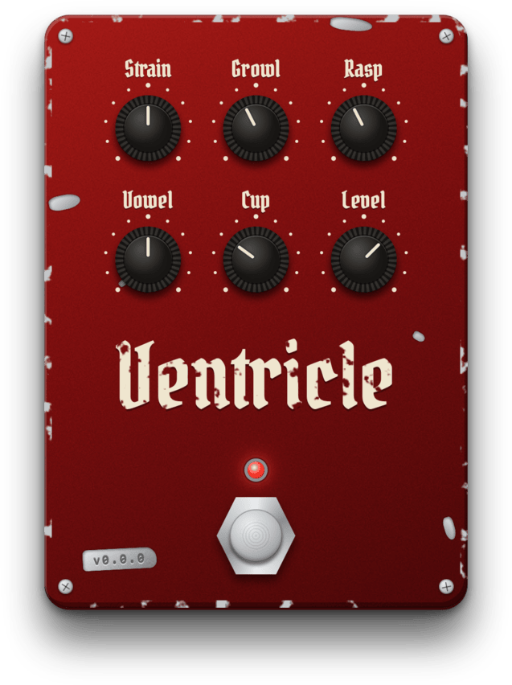

# Ventricle

Turns any voice, guitar or bass into screamed and growled metal vocals.



A VST3 and CLAP plugin for macOS and Windows.
<!-- Then a sentence or two on what it does to the sound and who it's for. -->

## How it works

<!-- A numbered list of what the engine does to the signal, in plain words. -->

## Controls

| Control | Range | What it does |
|---|---|---|
| Strain | 0–100% | How hard you have to push before the voice cracks |
| Growl | 0–100% | Subharmonics under the note, from a rough edge to a low growl |
| Rasp | 0–100% | Breath noise, for the hoarse hardcore yell |
| Vowel | OH, AH, EH | The vowel the scream opens into |
| Cup | 0–100% | The boxy honk of a mic cupped in the hand |
| Level | -24 to +12 dB | Output level |
| Stomp | On / Off | The footswitch. Off fades the effect out and passes the input untouched |

Only Level changes the sound so far. The other knobs are in place for the
scream engine, which comes next.

Drag a knob up or down (hold Shift for fine moves), scroll, or use the
arrow keys. Double-click a knob to reset it.

## Tips

<!-- A few settings for particular sounds. -->

## Installing

Download the zip from
[Releases](https://github.com/starzonmyarmz/ventricle/releases/latest)
and follow `INSTALL.txt` inside it. The plugin isn't signed or
notarized, so macOS may need `xattr -dr com.apple.quarantine` on it
first; `INSTALL.txt` has the exact command.

## Building

```sh
cargo xtask bundle ventricle --release   # target/bundled/Ventricle.{vst3,clap}
scripts/install.sh                        # bundle, sign ad hoc and install on macOS as X.Y.Z-dev+<sha>
scripts/clap-validator.sh "target/bundled/Ventricle.clap"
cargo fmt --all && cargo clippy --workspace --all-targets -- -D warnings
```

Local installs call themselves `X.Y.Z-dev+<sha>` on the panel, so you
can tell which build the host loaded. Only releases change the version.

## Tests

`cargo test` runs the engine offline, in host-sized blocks, against
stored golden renders and synthetic checks. After an intended change to
the sound, rerun with `BLESS=1` to rewrite the renders, and listen to
them before committing.

## Working on the UI

The editor is a webview showing `ui/index.html`, which is compiled into
the plugin. Without the plugin, the page runs against a mock, so you can
work on it in a browser:

```sh
cd ui && python3 -m http.server 8765    # open http://127.0.0.1:8765
```

Add `?version=1.2.0` to show a version other than `0.0.0`. To load
the page live in the plugin, set `VENTRICLE_UI_URL` to that URL
before starting the host.

## CI and releases

Versions follow [SemVer](https://semver.org), and the commits since the
last release decide the bump:

| Commits since the last release | Bump |
|---|---|
| a `!` or `BREAKING CHANGE:` footer | major (minor before 1.0) |
| `feat` | minor |
| `fix`, `perf`, `revert` | patch |
| anything else | no release |

`scripts/release` shows the computed bump and the changelog, then
commits, tags `vX.Y.Z` and pushes. Pass `patch`, `minor`, `major` or an
exact version to override, and `--dry-run` to only look. It refuses to
release `feat`, `fix` or `perf` commits while `[Unreleased]` in
[CHANGELOG.md](CHANGELOG.md) is empty.

- `check.yml` runs on pushes to main and on PRs: `cargo fmt --check`
  and clippy, the tests and clap-validator on macOS, and clap-validator
  on the Windows build.
- `changelog.yml` runs on PRs and fails when a `feat`, `fix` or `perf`
  commit doesn't touch `CHANGELOG.md`. Add the `no-changelog` label or
  put `[skip changelog]` in the subject to opt out.
- `release.yml` runs on `vX.Y.Z` tags. The tag must match `version` in
  the root `Cargo.toml`. It tests, builds a universal macOS bundle and a
  Windows bundle, validates both, and publishes `ventricle-X.Y.Z.zip`
  with `INSTALL.txt` and `SHA256SUMS`, using the version's changelog
  section as the release notes.
- Nothing on GitHub takes screenshots. `scripts/release` retakes
  `docs/ventricle.png` through `scripts/pre-release.sh` before the
  release commit, so the shot shows the new version. Between releases,
  retake it with `scripts/screenshot.sh` and commit it with the UI
  change it shows.

## Built with

- [nice-plug](https://codeberg.org/RustAudio/nice-plug), pinned to
  [a fork](https://github.com/starzonmyarmz/nice-plug/tree/patina) that
  adds `ActivateContext::gui_context()`.
- Started from
  [project-kit](https://github.com/starzonmyarmz/project-kit).
